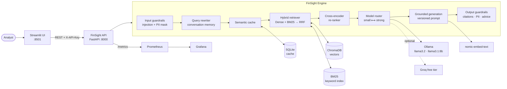
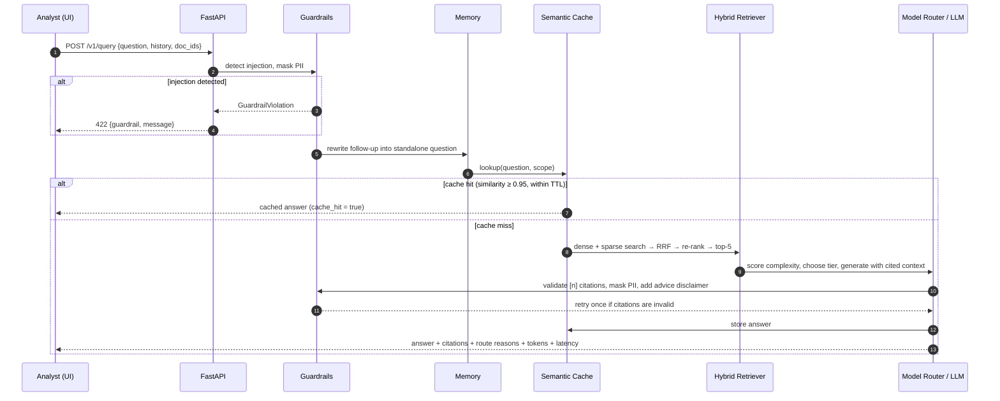
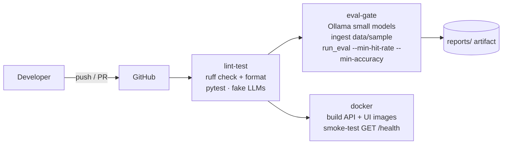
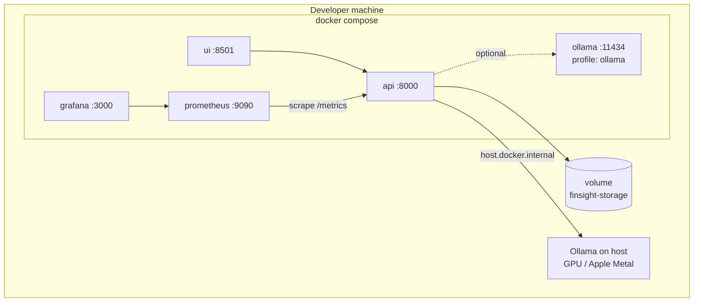
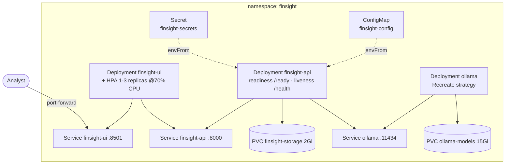

# FinSight AI

### Compliance-Aware Financial Research Copilot for Banking & Financial Services


> 📄 **Learners, start here: [docs/PROJECT_BRIEF.md](docs/PROJECT_BRIEF.md).** It contains the business scenario, weekly milestones, submission checklist and grading rubric. Section [14](#14-build-roadmap--implementation-status) of this README lists every component you implement.

---

## Table of Contents

1. [Project Overview](#1-project-overview)
2. [Business Problem](#2-business-problem)
3. [Objectives](#3-objectives)
4. [Key Features](#4-key-features)
5. [Architecture](#5-architecture)
6. [Tech Stack](#6-tech-stack)
7. [Folder Structure](#7-folder-structure)
8. [API Documentation](#8-api-documentation)
9. [Security Implementation](#9-security-implementation)
10. [CI/CD Pipeline](#10-cicd-pipeline)
11. [Deployment Architecture](#11-deployment-architecture)
12. [Monitoring & Observability](#12-monitoring--observability)
13. [Installation & Setup](#13-installation--setup)
14. [Build Roadmap & Implementation Status](#14-build-roadmap--implementation-status)
15. [Evaluation Framework](#15-evaluation-framework)
16. [Challenges & Learnings](#16-challenges--learnings)
17. [Future Enhancements](#17-future-enhancements)
18. [Troubleshooting](#18-troubleshooting)
19. [License](#19-license)

---

## 1. Project Overview

| | |
| --- | --- |
| **Project Name** | FinSight AI |
| **Domain** | Banking, Financial Services & Insurance (BFSI) |
| **Type** | Retrieval-Augmented Generation (RAG) platform with guardrails and LLMOps |
| **Target Users** | Research analysts, credit officers and compliance teams at a regulated bank |
| **Runtime Cost** | ₹0. Every model, database and tool is free and open source |

**FinSight AI** is a production-style GenAI copilot that answers questions about annual reports, quarterly results, investor presentations and regulatory circulars. **Every answer is grounded in source documents and cites the exact document, page and section.**

Because it is designed for a **regulated financial institution**, the system goes beyond a typical chatbot:

- Customer PII is masked **before** it reaches any language model.
- Prompt-injection attempts are detected and blocked.
- Investment-advice questions receive a regulatory disclaimer.
- Simple questions go to a small, cheap model; analytical questions go to a stronger model.
- Repeated questions are served from a semantic cache at zero LLM cost.

**Business value:** a question such as *"How did the Gross NPA of this lender move over the last five quarters?"* typically takes an analyst about 30 minutes of searching through PDFs. FinSight AI aims to answer it in seconds, with an audit trail back to the source page.

---

## 2. Business Problem

### What problem this project solves
Banks process hundreds of pages of financial disclosures and regulatory circulars every day. Finding a specific figure, comparing metrics across periods, or confirming a compliance requirement is slow, manual and error-prone.

### Existing challenges

| Challenge | Impact |
| --- | --- |
| Information is spread across long, unstructured PDFs | Analysts spend hours on lookups instead of analysis |
| Generic LLM chatbots hallucinate numbers | Unverifiable answers are a **compliance and reputational risk** |
| Documents and queries can contain customer PII | Sending PII to an LLM can breach **DPDP Act** obligations |
| LLMs are vulnerable to prompt injection | Attackers can override instructions or extract data |
| Using the largest model for every query is expensive | Costs grow with usage, without any quality benefit for simple queries |

### Why the solution was needed
Leadership needed a copilot that is **trustworthy (cited and grounded), safe (PII and injection guardrails), compliant (no investment advice) and cost-efficient (routing and caching)**. Off-the-shelf chatbots meet none of these requirements together.

---

## 3. Objectives

| Category | Objectives |
| --- | --- |
| **Primary** | Answer financial questions accurately, with verifiable citations to document, page and section |
| **Technical** | Hybrid retrieval (dense + BM25 + RRF), optional cross-encoder re-ranking, versioned prompts, conversation memory, automated evaluation, containerised deployment, Prometheus metrics |
| **Business** | Cut research time, lower compliance risk, keep inference cost near zero with routing and caching |
| **Quality targets** | Retrieval hit-rate@5 **≥ 0.90**, answer accuracy **≥ 0.70**, **100%** of injection attempts blocked, **100%** of out-of-scope questions refused |
| **Expected outcomes** | A deployable API + UI, a measurable evaluation report, a Kubernetes deployment and an LLMOps dashboard |

---

## 4. Key Features

| Feature | Description | Business Benefit |
| --- | --- | --- |
| 📥 **Document ingestion** | PDF, Markdown and text loaders with page-level metadata; scanned PDFs are detected | Works with real-world financial disclosures |
| ✂️ **Structure-aware chunking** | Recursive splitting with overlap, markdown section paths, tables kept intact | Retrieved context keeps its meaning and its source location |
| 🔎 **Hybrid retrieval** | Dense vector search (ChromaDB) + BM25 keyword search, fused with Reciprocal Rank Fusion | Finds both semantic matches and exact jargon such as "GNPA" or "CRAR" |
| 🎯 **Re-ranking** *(optional)* | Cross-encoder `ms-marco-MiniLM-L-6-v2` re-scores the fused results | Higher precision in the final top-k context |
| 📌 **Grounded answers with citations** | Every fact is cited as `[n]`, linked to document, page and section; refuses when the answer is not in the sources | Auditable answers; no invented numbers |
| 🔁 **Self-correction retry** | Answers with invalid citations are regenerated with a corrective instruction | Fewer ungrounded answers reach users |
| 💬 **Conversation memory** | Follow-up questions ("and in Q1?") are rewritten into standalone queries | Natural multi-turn analyst workflow |
| 🛡️ **PII masking** | PAN, Aadhaar, card numbers (Luhn-validated), IFSC, phone, account and email are masked before any LLM call | Data-privacy compliance (DPDP Act) |
| 🚫 **Prompt-injection blocking** | Pattern-based detection rejects malicious instructions with HTTP 422 | Protects system behaviour and data |
| ⚖️ **Advice disclaimer** | Investment-advice questions are flagged and receive a regulatory disclaimer | Regulatory compliance |
| 🧠 **Semantic cache** | Similarity-based cache (threshold 0.95, 24 h TTL, scoped by document filter) stored in SQLite | Repeated questions cost nothing and return instantly |
| 🔀 **Explainable model router** | Complexity scoring sends simple queries to a small model and analytical ones to a strong model, with fallback and logged reasons | Lower cost and latency without losing quality |
| 🏷️ **Financial analytics** | Financial NER (fiscal periods, banking metrics; optional spaCy) and sentiment (lexicon or FinBERT) | Structured insight from unstructured text |
| 📊 **Automated evaluation** | Golden-set harness: hit-rate, MRR, accuracy, ROUGE-L, answer relevancy, optional LLM-as-judge faithfulness | Measurable, regression-tested quality |
| 🔐 **API-key authentication** | Optional `X-API-Key` header check on all business endpoints | Controlled access in shared environments |
| 📈 **Observability** | Prometheus metrics for requests, latency, tokens, routing, cache and guardrail events | Production-grade LLMOps visibility |
| 🐳 **Container & Kubernetes ready** | Multi-stage, non-root Docker images; Compose stack; minikube manifests with probes | Repeatable deployment from laptop to cluster |

---

## 5. Architecture

### High-level architecture



### Query request flow



### Component interactions & data flow

| Stage | Data flow |
| --- | --- |
| **Ingestion** | File → loader (page text + metadata) → structure-aware chunker → embeddings (`nomic-embed-text`) → ChromaDB + BM25 index. Re-ingesting a document replaces its chunks instead of duplicating them. |
| **Query** | Question → guardrails → rewrite → cache → hybrid retrieval → re-rank → router → LLM → citation validation → response. |
| **Observability** | Every request, LLM call, cache lookup, routing decision and guardrail event updates a Prometheus metric, which Grafana visualises. |
| **Evaluation** | The golden set runs through the same engine; results are written to `reports/` and can fail CI below quality thresholds. |

---

## 6. Tech Stack

### Frontend
| Technology | Purpose |
| --- | --- |
| Streamlit 1.66 | Analyst UI: document upload, chat, citation viewer, routing and cache indicators |

### Backend
| Technology | Purpose |
| --- | --- |
| Python 3.12 | Core language |
| FastAPI 0.143 + Uvicorn | REST API with OpenAPI docs at `/docs` |
| Pydantic 2 / pydantic-settings | Request validation and `FINSIGHT_`-prefixed environment configuration |
| httpx | Clients for Ollama and Groq |
| pypdf + pdfplumber | PDF text and table extraction |

### AI / ML
| Technology | Purpose |
| --- | --- |
| Ollama: `llama3.2` / `llama3.1:8b` | Small and strong local LLM tiers |
| Groq free tier *(optional)* | Larger hosted strong model (e.g. `llama-3.3-70b-versatile`) for machines without a GPU |
| `nomic-embed-text` | Text embeddings |
| rank-bm25 | Sparse keyword retrieval |
| sentence-transformers *(optional)* | Cross-encoder re-ranking |
| transformers / FinBERT *(optional)* | Financial sentiment |
| spaCy *(optional)* | Named-entity recognition |
| LangChain 1.x | Framework comparison experiment (`EnsembleRetriever`, LCEL) |
| PEFT / LoRA *(bonus)* | Fine-tuning Qwen2.5-0.5B on Google Colab |

### Data stores
| Technology | Purpose |
| --- | --- |
| ChromaDB 1.5 (embedded) | Vector store for chunk embeddings and metadata |
| SQLite | Semantic cache persistence |
| Local filesystem (`storage/`, `data/uploads/`) | Index persistence and uploaded documents |

### DevOps
| Technology | Purpose |
| --- | --- |
| Docker (multi-stage, non-root) | API and UI images |
| Docker Compose | Full local stack: API, UI, Prometheus, Grafana, optional Ollama |
| Kubernetes (minikube / kind) | Cluster deployment with ConfigMap, Secret, PVCs, probes and HPA |
| GitHub Actions | Lint (ruff), tests (pytest), evaluation quality gate, Docker smoke test |
| ruff | Linting and formatting |

### Monitoring
| Technology | Purpose |
| --- | --- |
| prometheus-client | Application metrics at `/metrics` |
| Prometheus 3.4 | Metrics collection (15 s scrape interval) |
| Grafana 12 | LLMOps dashboards (auto-provisioned data source) |

---

## 7. Folder Structure

```text
finsight-ai/
├── finsight/                    # Application package
│   ├── config.py                # Central settings (env vars prefixed FINSIGHT_)
│   ├── api/main.py              # FastAPI app: endpoints, auth, error handling, metrics middleware
│   ├── ingestion/               # loaders.py (PDF/MD/TXT), chunker.py (structure-aware chunks)
│   ├── retrieval/               # store.py (Chroma + BM25), hybrid.py (RRF + re-ranker)
│   ├── llm/                     # providers.py (Ollama/Groq clients), router.py (model router)
│   ├── rag/                     # engine.py (orchestration), prompts.py (versioned prompts)
│   ├── guardrails/              # pii.py (PII masking), policy.py (injection + citations)
│   ├── cache/                   # semantic_cache.py (SQLite semantic cache)
│   ├── analytics/               # entities.py (financial NER), sentiment.py
│   └── observability/           # metrics.py (Prometheus counters, histograms, gauges)
├── ui/streamlit_app.py          # Analyst-facing web UI
├── evaluation/                  # golden_set.jsonl, metrics.py, run_eval.py (harness + CI gate)
├── experiments/                 # langchain_baseline.py (framework comparison)
├── scripts/                     # doctor.py (env check), ingest.py (CLI ingest), progress.py
├── data/sample/                 # 4 synthetic financial documents (fictional companies)
├── tests/                       # 92 acceptance tests + PDF fixtures
├── docker/                      # Dockerfiles, Prometheus config, Grafana provisioning
├── k8s/finsight.yaml            # Kubernetes manifests
├── finetune/                    # LoRA fine-tuning (Colab) + Ollama Modelfile
├── docs/                        # PROJECT_BRIEF.md, EVALUATION_REPORT.md
├── .github/workflows/ci.yml     # CI pipeline
├── docker-compose.yml
├── .env.example
└── requirements*.txt            # core, dev, ML extras, Intel-Mac extras, experiments
```

| Folder | Why it matters |
| --- | --- |
| `finsight/rag/` | The orchestration core: every query passes through `engine.py` |
| `finsight/guardrails/` | Compliance controls: PII, injection and citation validation |
| `evaluation/` | The quality contract: thresholds here gate deployments |
| `tests/` | Acceptance criteria for every component, run with fake LLMs (fast, deterministic) |
| `docker/`, `k8s/` | Deployment from laptop to cluster |

### Sample corpus (fictional)

| Document | Type |
| --- | --- |
| `trivenza_bank_annual_report_fy2025.md` | Annual report |
| `trivenza_bank_q1_fy2026_results.md` | Quarterly results |
| `solvantra_finance_investor_presentation_q4_fy2025.md` | Investor presentation |
| `fsra_circular_digital_lending_kyc_2025.md` | Regulatory circular |

> Trivenza Bank, Solvantra Finance and the regulator FSRA are **fictional**. Answers about them are not real financial information.

---

## 8. API Documentation

### Overview
REST API served by FastAPI. Interactive OpenAPI docs: **`http://localhost:8000/docs`**.

### Authentication
If `FINSIGHT_API_KEY` is set, all `/v1/*` endpoints require the header `X-API-Key: <key>`. If it is empty, authentication is disabled for local development.

### Endpoints

| Method | Endpoint | Description |
| --- | --- | --- |
| `GET` | `/health` | Liveness check: `{status, version}` |
| `GET` | `/ready` | Readiness: index size, re-ranker status, entity backend, models, auto-ingest state. Returns 503 while ingesting |
| `GET` | `/metrics` | Prometheus metrics |
| `POST` | `/v1/query` | Ask a question, with optional document filter, cache control, forced tier and chat history |
| `POST` | `/v1/documents` | Upload and index a `.pdf`, `.md` or `.txt` file (max 25 MB by default) |
| `GET` | `/v1/documents` | List indexed documents |
| `DELETE` | `/v1/documents/{doc_id}` | Remove a document and its chunks |
| `POST` | `/v1/analyze/sentiment` | Financial sentiment of a text |
| `POST` | `/v1/analyze/entities` | Financial entities (fiscal periods, metrics, …) in a text |
| `DELETE` | `/v1/cache` | Clear the semantic cache |

### Request example

```bash
curl -X POST http://localhost:8000/v1/query \
  -H "Content-Type: application/json" \
  -H "X-API-Key: $FINSIGHT_API_KEY" \
  -d '{
        "question": "And in Q1?",
        "history": [
          {"role": "user", "content": "What was Trivenza Bank'\''s Gross NPA in FY2024-25?"},
          {"role": "assistant", "content": "..."}
        ],
        "doc_ids": null,
        "use_cache": true,
        "force_tier": null
      }'
```

### Response shape

```json
{
  "answer": "… [1] …",
  "citations": [
    {"n": 1, "doc_id": "…", "title": "…", "source": "…", "page": 3,
     "section": "…", "snippet": "…", "scores": {"…": 0.0}}
  ],
  "grounded": true,
  "model": "ollama:llama3.2",
  "tier": "small",
  "route_reasons": ["…"],
  "cache_hit": false,
  "cache_similarity": null,
  "pii_masked": {},
  "advice_disclaimer": false,
  "latency_ms": 0,
  "tokens": {},
  "rewritten_question": "What was Trivenza Bank's Gross NPA in Q1 FY2025-26?",
  "prompt_version": "v0.1"
}
```

### Error handling

| Status | When |
| --- | --- |
| `400` | Unsupported upload file type |
| `401` | Missing or invalid `X-API-Key` |
| `404` | Document not found on delete |
| `413` | Upload exceeds `FINSIGHT_MAX_UPLOAD_MB` |
| `422` | Request validation error, guardrail violation (`{"guardrail": kind, "message": …}`), or unreadable document |
| `501` | A component is not implemented yet; the message names the TODO to complete |
| `503` | LLM or embedding backend unavailable, or the service is not ready |

### API security
Input length limits on every field (questions ≤ 2,000 chars, history ≤ 10 turns, text ≤ 20,000 chars), a `user`/`assistant` role whitelist for history, a file-type allow-list, streamed size-limited uploads, and filename sanitisation.

---

## 9. Security Implementation

| Control | Implementation |
| --- | --- |
| **Authentication** | Optional shared API key through the `X-API-Key` header (`FINSIGHT_API_KEY`) |
| **PII protection** | PAN, Aadhaar, card (Luhn check), IFSC, phone, bank account and email are masked **before** embedding and before any LLM call, including in chat history |
| **Prompt-injection defence** | Input policy detects instruction-override and data-exfiltration patterns and rejects the request (HTTP 422) |
| **Output validation** | Citation numbers are checked against the retrieved sources; invalid answers trigger one corrective retry; ungrounded answers are counted |
| **Regulatory compliance** | Investment-advice questions get a disclaimer; the answer must say so when it is not in the sources |
| **Input validation** | Pydantic schemas with length limits and enumerated values |
| **Upload safety** | Extension allow-list, 25 MB limit enforced while streaming, path-traversal-safe filenames |
| **Secrets management** | `.env` (git-ignored) locally; Kubernetes `Secret` for the API key and Groq key in-cluster |
| **Container hardening** | Multi-stage builds, slim base images, non-root user (UID 10001) |
| **Data residency** | Default configuration runs fully local with Ollama; no data leaves the machine |

Guardrails can be toggled with `FINSIGHT_PII_MASKING` and `FINSIGHT_INJECTION_BLOCKING`.

---

## 10. CI/CD Pipeline



| Stage | What happens |
| --- | --- |
| **Trigger** | Push to `main`, pull requests, or manual dispatch |
| **Lint & test** | `ruff check`, `ruff format --check`, then 92 acceptance tests with fake LLMs: fast, deterministic, no model downloads |
| **Evaluation quality gate** | Runs the golden set against free small models; **the pipeline fails** if hit-rate or accuracy drop below thresholds, so a prompt or retrieval change that lowers quality cannot be merged |
| **Docker smoke test** | Builds both images and checks `GET /health` |
| **Artifacts** | Evaluation reports are uploaded for every run |

> The `lint-test` job is provided. The `eval-gate` and `docker` jobs are part of the Week 3 build (see [Section 14](#14-build-roadmap--implementation-status)).

---

## 11. Deployment Architecture

### Docker Compose (local)



The API **auto-ingests `data/sample`** on first start, and `/ready` returns 503 until indexing is complete.

### Kubernetes (minikube)



| Component | Design |
| --- | --- |
| **Ollama** | Single replica, `Recreate` strategy (one ReadWriteOnce model volume), 2 CPU / 6–10 Gi memory |
| **API** | Probes on `/ready` and `/health`, resource limits, non-root, Prometheus scrape annotations, persistent storage for the embedded Chroma index |
| **UI** | Stateless; horizontally autoscaled |
| **Config** | Non-secret settings in a ConfigMap; API and Groq keys in a Secret |

---

## 12. Monitoring & Observability

| Metric | Type | Labels | Insight |
| --- | --- | --- | --- |
| `finsight_requests_total` | Counter | endpoint, status | Traffic and error rate |
| Query latency | Histogram | – | End-to-end p50 / p95 latency |
| LLM latency | Histogram | – | Model response time |
| `finsight_llm_tokens_total` | Counter | model, kind | Token usage and cost proxy per model |
| `finsight_route_total` | Counter | tier | Small vs strong routing split |
| `finsight_cache_total` | Counter | result | Cache hit rate and savings |
| `finsight_guardrail_events_total` | Counter | type | PII masks, injection blocks, retries |
| `finsight_ungrounded_answers_total` | Counter | – | Answers without valid citations |
| `finsight_indexed_chunks` | Gauge | – | Knowledge-base size |

**Dashboards:** Grafana at `http://localhost:3000`, with Prometheus auto-provisioned as a data source. The LLMOps dashboard covers query volume, p95 latency, cache hit-rate, router split, tokens by model and guardrail events. Dashboard JSON is loaded from `docker/grafana/dashboards/`.

---

## 13. Installation & Setup

### Prerequisites

| Tool | Install | Needed for |
| --- | --- | --- |
| Python 3.12 | [python.org](https://www.python.org/downloads/) | Everything |
| Ollama | [ollama.com/download](https://ollama.com/download) | Local LLMs and embeddings |
| Docker Desktop | [docker.com](https://www.docker.com/products/docker-desktop/) | Week 3 |
| minikube + kubectl | [minikube.sigs.k8s.io](https://minikube.sigs.k8s.io/docs/start/) | Week 3 |

**Hardware:** 16 GB RAM recommended. Without a GPU, local 8B models are slow (about 50 s per answer on CPU), so use the free Groq tier for the strong model. On 8 GB RAM use `llama3.2:1b` (small) + Groq (strong). Apple Silicon runs the local models comfortably.

### 1. Clone the repository
```bash
git clone https://github.com/Skillfyme-R/GenAI-CapStone-Project.git
cd GenAI-CapStone-Project
```

### 2. Pull the free local models
```bash
ollama pull llama3.2          # small tier (2 GB)
ollama pull llama3.1:8b       # strong tier (4.9 GB)
ollama pull nomic-embed-text  # embeddings (274 MB)
```

### 3. Create the Python environment
```bash
python3.12 -m venv .venv
source .venv/bin/activate          # Windows: .venv\Scripts\activate
pip install -r requirements-dev.txt
cp .env.example .env              # Windows: copy .env.example .env
```

> **Windows:** use PowerShell or Windows Terminal, install Python from python.org (tick *Add to PATH*), and use `py -3.12 -m venv .venv` if `python3.12` is not found.

Optional ML extras (re-ranker, FinBERT, spaCy NER; CPU is fine):
```bash
pip install -r requirements-ml.txt && python -m spacy download en_core_web_sm
# Intel Mac: use requirements-ml-intel-mac.txt instead
```

### 4. Environment variables

All settings are in [`finsight/config.py`](finsight/config.py) and can be overridden with `FINSIGHT_*` variables in `.env`.

| Variable | Default | Purpose |
| --- | --- | --- |
| `FINSIGHT_OLLAMA_URL` | `http://localhost:11434` | Ollama endpoint |
| `FINSIGHT_SMALL_PROVIDER` / `_MODEL` | `ollama` / `llama3.2` | Small tier |
| `FINSIGHT_STRONG_PROVIDER` / `_MODEL` | `ollama` / `llama3.1:8b` | Strong tier (`groq` supported) |
| `FINSIGHT_GROQ_API_KEY` | – | Groq free-tier key |
| `FINSIGHT_EMBED_MODEL` | `nomic-embed-text` | Embedding model |
| `FINSIGHT_CHUNK_SIZE` / `_OVERLAP` | `900` / `150` | Chunking |
| `FINSIGHT_TOP_K_FINAL` | `5` | Chunks passed to the LLM |
| `FINSIGHT_RERANKER_ENABLED` | `true` | Cross-encoder re-ranking |
| `FINSIGHT_CACHE_ENABLED` / `_THRESHOLD` / `_TTL_S` | `true` / `0.95` / `86400` | Semantic cache |
| `FINSIGHT_PII_MASKING` / `FINSIGHT_INJECTION_BLOCKING` | `true` | Guardrails |
| `FINSIGHT_API_KEY` | empty | Enables `X-API-Key` auth when set |
| `FINSIGHT_LLM_TIMEOUT_S` | `300` | LLM timeout (raise on slow CPUs) |
| `FINSIGHT_AUTO_INGEST_DIR` | empty | Folder the API ingests at startup if the index is empty |

### 5. Verify the environment
```bash
python -m scripts.doctor      # checks Python, packages, Ollama, models, RAM, GPU, Docker
python -m scripts.progress    # shows which acceptance tests pass, per week
```
Do not start coding until `doctor` reports **Environment ready**.

### 6. Run locally
```bash
python -m scripts.ingest data/sample                    # index the sample documents (API not running)
uvicorn finsight.api.main:app --reload                  # API  → http://localhost:8000/docs
streamlit run ui/streamlit_app.py                       # UI   → http://localhost:8501

# while the API is running, always ingest through it (one process must own the Chroma index)
python -m scripts.ingest data/sample --api http://localhost:8000
```

### 7. Test & evaluate
```bash
pytest                                     # 92 acceptance tests
pytest tests/test_chunker.py -x            # one component at a time
python -m evaluation.run_eval              # golden-set evaluation → reports/
python -m evaluation.run_eval --judge      # + LLM-as-judge faithfulness
pip install -r requirements-experiments.txt && python -m experiments.langchain_baseline
```

### 8. Docker setup
```bash
docker compose up -d --build
# API :8000/docs · UI :8501 · Prometheus :9090 · Grafana :3000 (admin/admin)

# no Ollama on the host? use the bundled one and set DOCKER_OLLAMA_URL=http://ollama:11434 in .env
docker compose --profile ollama up -d
```

### 9. Kubernetes setup
```bash
minikube start --cpus 4 --memory 8g
eval $(minikube docker-env)
docker build -t finsight-api:1.0.0 -f docker/Dockerfile.api .
docker build -t finsight-ui:1.0.0  -f docker/Dockerfile.ui .
kubectl apply -f k8s/finsight.yaml
kubectl -n finsight exec deploy/ollama -- ollama pull llama3.2   # repeat for llama3.1:8b, nomic-embed-text
kubectl -n finsight port-forward svc/finsight-ui 8501:8501
```

### 10. Verification
```bash
curl http://localhost:8000/health      # {"status":"ok", ...}
curl http://localhost:8000/ready       # {"status":"ready", "indexed_chunks": ...}
kubectl get pods -n finsight           # all pods Running
```
Then ask in the UI: *"What was Trivenza Bank's net profit in FY2024-25?"*. The answer should include a citation.

---

## 14. Build Roadmap & Implementation Status

This repository is a **hands-on capstone**. Configuration, LLM clients, document loaders, the API, the UI, sentiment analysis, metrics, Docker images and all acceptance tests are **provided**. The GenAI engineering core is **yours to implement**: each TODO raises `NotImplementedError` with a pointer (e.g. `W1: implement _split_recursive`), and the API returns HTTP 501 naming the missing piece.

| Week | Component | File | What you implement |
| --- | --- | --- | --- |
| **W1** | Chunking | `finsight/ingestion/chunker.py` | `_split_recursive`, `_sections` |
| **W1** | Retrieval | `finsight/retrieval/store.py` | `dense_search`, `sparse_search` |
| **W1** | Fusion | `finsight/retrieval/hybrid.py` | `reciprocal_rank_fusion` (+ `rerank` in W2) |
| **W1** | Model router | `finsight/llm/router.py` | `score_complexity`, `ModelRouter.chat` |
| **W1** | Financial NER | `finsight/analytics/entities.py` | `FISCAL_PERIOD`, `METRIC` patterns |
| **W1** | Prompting | `finsight/rag/prompts.py` | `SYSTEM_PROMPT` |
| **W1–W2** | RAG engine | `finsight/rag/engine.py` | `retrieve`, `query`, `rewrite_query` |
| **W2** | PII guardrail | `finsight/guardrails/pii.py` | PII regexes, `_luhn_ok`, `mask_pii` |
| **W2** | Policy guardrail | `finsight/guardrails/policy.py` | injection patterns, `detect_injection`, `validate_citations` |
| **W2** | Semantic cache | `finsight/cache/semantic_cache.py` | `lookup`, `store` |
| **W2** | Metrics | `evaluation/metrics.py` | `lcs_length`, `rouge_l_f1` |
| **W2** | Framework comparison | `experiments/langchain_baseline.py` | LangChain retriever + LCEL chain |
| **W2** | Golden set | `evaluation/golden_set.jsonl` | Extend to 30+ questions with reference answers |
| **W3** | Kubernetes | `k8s/finsight.yaml` | API + UI manifests, HPA |
| **W3** | CI/CD | `.github/workflows/ci.yml` | Evaluation gate, Docker smoke test |
| **W3** | Observability | `docker/grafana/dashboards/` | LLMOps dashboard |
| **W3** | Documentation | `README.md`, `docs/EVALUATION_REPORT.md` | Architecture, results, experiment log, demo video |
| **Bonus** | Fine-tuning | `finetune/train_lora.py` | LoRA config, prompt-masked labels |
| **Bonus** | Real documents | `data/raw/` | 5+ real RBI/SEBI documents + 10 golden questions |

```bash
grep -rn "TODO" finsight evaluation experiments k8s .github finetune   # find every TODO
python -m scripts.progress                                             # track completion per week
```

**Exit criteria:** all 92 acceptance tests pass, hit-rate@5 ≥ 0.90, accuracy ≥ 0.70, 100% of injections blocked and 100% of out-of-scope questions refused. **Do not modify the tests**; graders run the original suite.

---

## 15. Evaluation Framework

| Metric | Measures |
| --- | --- |
| **Hit-rate@5** | Whether the correct source document appears in the top 5 retrieved chunks |
| **MRR** | How high the correct source is ranked |
| **Answer accuracy** | Required keywords/figures are present in the answer |
| **ROUGE-L F1** | Longest-common-subsequence overlap with the reference answer |
| **Answer relevancy** | Embedding similarity between question and answer |
| **Faithfulness** *(`--judge`)* | LLM-as-judge check that the answer is supported by the cited context |
| **Refusal / injection rates** | Out-of-scope questions refused; adversarial prompts blocked |

The harness is resilient: a slow or failed model call is scored as a failed case instead of stopping the run. Results go to `reports/` and are summarised in [`docs/EVALUATION_REPORT.md`](docs/EVALUATION_REPORT.md), together with the experiment change log and the LangChain-vs-custom retriever comparison.

---

## 16. Challenges & Learnings

### Technical challenges
| Challenge | Approach |
| --- | --- |
| Financial jargon (GNPA, CRAR, PCR) is poorly captured by embeddings alone | Hybrid dense + BM25 retrieval |
| Dense and BM25 scores are on incompatible scales | **Reciprocal Rank Fusion** combines ranks, not raw scores, so no normalisation is needed |
| Tables lose meaning when split | Structure-aware chunking keeps tables intact and records section paths |
| Follow-up questions lack context for retrieval | An LLM rewrites them into standalone questions using recent history |

### Architecture challenges
- **Embedded vector store vs. scaling:** Chroma runs embedded in the API process, so one process must own the index. This limits the API to a single replica and makes ingestion through the API mandatory while it runs.
- **Readiness during ingestion:** `/ready` returns 503 until auto-ingestion finishes, so Kubernetes keeps traffic away from a half-built index.
- **Container networking:** separate `DOCKER_OLLAMA_URL` and `FINSIGHT_OLLAMA_URL` variables, because `localhost` inside a container is the container itself.

### Performance challenges
- 8B models on CPU take about 50 s per answer. The router sends simple questions to the small tier, and the strong tier can move to Groq's free hosted models.
- The semantic cache removes LLM cost for repeated questions. It is scoped by document filter and expires after a TTL, so cached answers do not go stale.

### Security challenges
- **PII is masked before embedding**, not just before generation, so it never persists in the vector store or in prompts.
- Citation validation with a single corrective retry trades a small latency cost for far fewer ungrounded answers.

### Key learnings
- In regulated domains, **evaluation is a release gate, not an afterthought**. Quality thresholds belong in CI.
- Explainable routing (logged reasons) makes cost optimisation auditable.
- Versioned prompts (`PROMPT_VERSION`) make prompt changes traceable in evaluation reports.

---

## 17. Future Enhancements

| Enhancement | Business Impact |
| --- | --- |
| Client-server vector database (Chroma server, Qdrant, pgvector) | Horizontal scaling of the API beyond one replica |
| Role-based access and per-team document scopes | Enforce need-to-know access to confidential documents |
| OAuth2 / SSO integration | Enterprise identity instead of a shared API key |
| ML-based injection and PII classifiers | Catch attacks and PII formats that regexes miss |
| LoRA-tuned small model as the default tier | Better domain accuracy at the lowest cost |
| Streaming responses | Faster perceived latency for long analytical answers |
| OCR pipeline for scanned PDFs | Support for legacy and scanned disclosures |
| Automated ingestion from RBI/SEBI feeds | Always up-to-date regulatory knowledge base |
| Alerting rules (latency, ungrounded-answer spikes) | Proactive incident response |
| Multi-document comparison views in the UI | Faster cross-period and peer analysis |

---

## 18. Troubleshooting

| Problem | Fix |
| --- | --- |
| `Ollama call failed ... Connection refused` | Start Ollama (`ollama serve`, or open the Ollama app) |
| Answers are very slow (no GPU) | Use Groq for the strong model: `FINSIGHT_STRONG_PROVIDER=groq`, `FINSIGHT_STRONG_MODEL=llama-3.3-70b-versatile`, `FINSIGHT_GROQ_API_KEY=...` |
| `LLM backend unavailable ... timed out` | Set `FINSIGHT_LLM_TIMEOUT_S=600` in `.env`, or use Groq. Close other heavy apps during evaluation |
| API errors after running `scripts.ingest` while the API was up | Restart the API, then ingest with `--api http://localhost:8000` |
| `NotImplementedError: W1: ...` | That function is your next TODO |
| Docker container cannot reach Ollama | Keep `DOCKER_OLLAMA_URL=http://host.docker.internal:11434` (Linux: `http://172.17.0.1:11434`) |
| Scanned PDF has no text | `ocrmypdf input.pdf output.pdf` (free), then ingest the output |

---

## 19. License

© Learnsyte Learning Private Limited (Skillfyme). All rights reserved.
