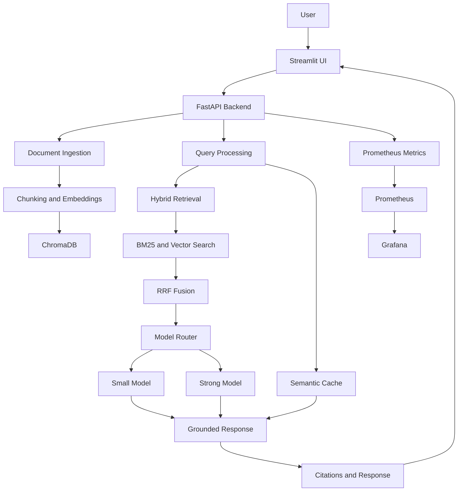

# FinSight AI – Financial Document Intelligence using GenAI

## 1. Project Overview

FinSight AI is a Generative AI-powered financial document intelligence platform designed to help users extract meaningful insights from financial reports, regulatory documents and business documents using natural language.

Traditional financial document analysis requires users to manually read lengthy reports, locate relevant financial information, compare figures across reporting periods and interpret business performance. This process is time-consuming and makes it difficult to efficiently retrieve information from multiple documents.

FinSight AI addresses this problem by combining Retrieval-Augmented Generation (RAG), hybrid search, intelligent model routing, semantic caching and security guardrails to provide context-grounded answers with source citations.

The platform also includes an evaluation framework and operational monitoring to measure answer quality, retrieval performance, latency, security behaviour and application health.

## 2. Problem Statement

Financial reports, annual reports, regulatory guidelines and financial statements contain large amounts of structured and unstructured information.

Users face several challenges:

- Finding specific financial figures across lengthy documents.
- Understanding financial information using natural language queries.
- Comparing financial performance across reporting periods.
- Identifying relevant information without manually searching entire documents.
- Verifying AI-generated answers against the original source.
- Reducing response latency and unnecessary LLM usage.
- Preventing sensitive information from being exposed during AI processing.
- Evaluating the reliability and accuracy of AI-generated responses.

FinSight AI aims to provide an intelligent document analysis solution that improves the accessibility, efficiency, traceability and reliability of financial information retrieval.

## 3. Solution Approach

FinSight AI combines multiple AI and application engineering components into a single platform.

### 3.1 Document ingestion

Users can upload financial documents through the application interface.

The ingestion pipeline:

1. Accepts uploaded documents.
2. Extracts text and document content.
3. Processes the content into manageable chunks.
4. Generates embeddings for semantic retrieval.
5. Stores the processed chunks and embeddings in the vector store.

### 3.2 Hybrid retrieval

FinSight AI combines semantic retrieval and keyword-based retrieval to improve document search.

- Vector retrieval identifies semantically relevant content.
- BM25 keyword retrieval identifies relevant terms and phrases.
- Reciprocal Rank Fusion (RRF) combines retrieval results.
- Retrieved content is used as context for answer generation.

This approach helps retrieve relevant information when queries use different wording from the source document.

### 3.3 Retrieval-Augmented Generation

The RAG pipeline retrieves relevant document context before generating a response.

The workflow:

1. Accept a user question.
2. Retrieve relevant document chunks.
3. Combine the question with retrieved context.
4. Generate a context-grounded answer.
5. Return the response with citations.

The system is designed to answer using retrieved information and handle unsupported questions through its refusal and guardrail logic.

### 3.4 Intelligent model routing

FinSight AI uses model routing to select an appropriate model tier depending on the complexity of the query.

- **Small tier:** Intended for simpler factual queries.
- **Strong tier:** Intended for analytical, comparative or more complex queries.

This approach aims to balance response quality, latency and LLM cost.

### 3.5 Conversational follow-up handling

The application supports follow-up questions using conversational context.

A follow-up question can be rewritten into a standalone query before retrieval, allowing the system to understand the context of the previous conversation.

### 3.6 Semantic caching

FinSight AI implements semantic caching to reduce repeated LLM generation.

When a similar query is received, the system checks the semantic cache. If an appropriate cached response is available, it can return the cached result instead of performing the complete generation process again.

Benefits:

- Reduced response latency.
- Reduced unnecessary LLM calls.
- Improved efficiency.
- Potential reduction in LLM usage costs.

### 3.7 Security and guardrails

FinSight AI incorporates security mechanisms to improve safe AI processing.

Implemented capabilities include:

- Prompt injection detection and blocking.
- PII detection and masking.
- PAN masking.
- Guardrail event tracking.
- Handling unsupported or out-of-scope questions.
- Citation and grounding checks.

### 3.8 Evaluation framework

The project includes a golden question set and automated evaluation framework.

The evaluation covers:

- Factual questions.
- Analytical questions.
- Out-of-scope questions.
- Security and prompt injection cases.
- PII-related cases.

Metrics include retrieval quality, answer accuracy, citation rate, refusal accuracy, guardrail accuracy, answer relevancy and latency.

### 3.9 Operational monitoring

The application exposes Prometheus metrics for monitoring application and AI behaviour.

Grafana provides visualisation of:

- API request metrics.
- Query latency.
- LLM latency.
- Token usage.
- Model routing decisions.
- Semantic cache hits and misses.
- Guardrail events.
- Ungrounded answers.
- Indexed document chunks.
- API process CPU and memory.

---

## 4. Architecture



### Technology stack

| Component | Technology |
|---|---|
| Backend | Python, FastAPI |
| Frontend | Streamlit |
| LLM integration | Groq / configured LLM provider |
| Embeddings | Configured embedding provider |
| Vector database | ChromaDB |
| Retrieval | Hybrid retrieval, BM25, vector search, RRF |
| Model routing | Small and strong model tiers |
| Cache | Semantic cache |
| API monitoring | Prometheus metrics |
| Monitoring dashboards | Grafana |
| Containerisation | Docker |
| Container orchestration | Kubernetes |
| Local Kubernetes environment | Minikube |
| Evaluation | Golden-set evaluation framework |
| API validation | Health and readiness endpoints |

---

## 5. Repository Structure

The project structure includes the following key components:

```text
Capstone-1-FinSight-AI/
├── finsight/
│   ├── api/
│   ├── ingestion/
│   ├── retrieval/
│   ├── rag/
│   ├── llm/
│   ├── security/
│   ├── cache/
│   └── evaluation/
├── ui/
├── scripts/
├── evaluation/
├── experiments/
├── data/
│   └── sample/
├── docs/
│   └── EVALUATION_REPORT.md
├── docker/
│   ├── Dockerfile.api
│   ├── Dockerfile.ui
│   ├── prometheus/
│   └── grafana/
├── k8s/
│   └── monitoring/
├── tests/
├── requirements.txt
├── requirements-ml.txt
├── requirements-experiments.txt
├── docker-compose.yml
└── README.md
```

The exact repository contents may evolve as additional features and experiments are added.

---

## 6. Prerequisites

Ensure the following tools are installed.

| Dependency | Purpose |
|---|---|
| Python 3.12 | Backend and AI application |
| pip | Python dependency installation |
| Git | Source code management |
| Docker | Containerisation |
| Docker Compose | Multi-container execution |
| Minikube | Local Kubernetes deployment |
| kubectl | Kubernetes management |
| Prometheus | Metrics collection |
| Grafana | Monitoring and visualisation |

An API key for the configured LLM provider may be required depending on the provider and configuration.

---

## 7. Installation and Setup

### 7.1 Clone the repository

```bash
git clone https://github.com/st-devsecops/GenAI.git
cd GenAI/Capstone-1-FinSight-AI
```

### 7.2 Create a Python virtual environment

```bash
python3 -m venv venv
```

Activate the environment.

macOS/Linux:

```bash
source venv/bin/activate
```

### 7.3 Install dependencies

```bash
pip install --upgrade pip
pip install -r requirements.txt
```

Optional ML dependencies:

```bash
pip install -r requirements-ml.txt
```

Optional experiment dependencies:

```bash
pip install -r requirements-experiments.txt
```

Optional dependencies are required only for the associated experiments or features.

### 7.4 Configure environment variables

Configure the required provider credentials and application settings according to the configuration supported by the project.

Example configuration:

```bash
export FINSIGHT_API_KEY="your-api-key"
```

The actual API key variable depends on the configured LLM provider and application configuration.

Do not commit API keys, credentials, tokens or secrets to GitHub.

---

## 8. Running FinSight AI Locally

### 8.1 Start the backend

Run the FastAPI backend using the project's API entry point.

The backend provides API endpoints for:

- Health checks.
- Readiness checks.
- Document upload and management.
- Question answering.
- Document analysis.
- Metrics collection.

The API is configured to run on port 8000.

### 8.2 Start the UI

Run the Streamlit application using the UI entry point configured in the project.

The UI is configured to communicate with the FastAPI backend.

Access the application through the configured Streamlit URL.

### 8.3 API endpoints

| Endpoint | Purpose |
|---|---|
| `/health` | Application health check |
| `/ready` | Readiness status |
| `/v1/query` | Query the RAG application |
| `/v1/documents` | Document management |
| `/metrics` | Prometheus metrics |

Refer to the API implementation for the exact request and response schemas.

---

## 9. Docker Deployment

FinSight AI includes Docker configuration for the backend and UI.

### Build API image

```bash
docker build \
  -f docker/Dockerfile.api \
  -t finsight-api:0.1.0 .
```

### Build UI image

```bash
docker build \
  -f docker/Dockerfile.ui \
  -t finsight-ui:0.1.0 .
```

### Start using Docker Compose

```bash
docker compose up -d
```

### Verify containers

```bash
docker compose ps
```

### Stop containers

```bash
docker compose down
```

Refer to the Docker Compose configuration for the configured ports, environment variables, volumes and services.

---

## 10. Kubernetes Deployment using Minikube

FinSight AI was deployed locally using Minikube.

### 10.1 Start Minikube

```bash
minikube start
```

### 10.2 Load local images

If images are built locally:

```bash
minikube image load finsight-api:0.1.0
minikube image load finsight-ui:0.1.0
```

If using tagged images from another registry, load the corresponding image tags.

### 10.3 Deploy FinSight

Apply the Kubernetes manifests from the project's Kubernetes deployment directory.

```bash
kubectl apply -f k8s/
```

If the manifests are organised into separate deployment directories, apply the namespace, configuration, storage, API and UI manifests in their configured order.

### 10.4 Verify the deployment

```bash
kubectl get pods -n finsight
kubectl get svc -n finsight
kubectl get pvc -n finsight
```

### 10.5 Access the UI

Access the deployed Streamlit application using the configured NodePort service or Minikube service access command.

### 10.6 Verify API health

```bash
kubectl port-forward -n finsight svc/finsight-api 8000:8000
```

In another terminal:

```bash
curl http://localhost:8000/health
```

---

## 11. Prometheus and Grafana Monitoring

FinSight AI includes application-level Prometheus metrics and a Grafana dashboard.

### 11.1 Prometheus

Prometheus is deployed in the FinSight Kubernetes namespace and scrapes the API metrics endpoint.

The configured scrape target:

```text
finsight-api.finsight.svc.cluster.local:8000
```

Metrics endpoint:

```text
/metrics
```

### 11.2 Verify Prometheus

Access Prometheus using port forwarding:

```bash
kubectl port-forward -n finsight svc/prometheus 9090:9090
```

Open:

```text
http://localhost:9090
```

Check the Prometheus targets page and verify that the FinSight API target is UP.

### 11.3 Grafana

Grafana is deployed with a Prometheus datasource.

Access Grafana using the configured service or port forwarding:

```bash
kubectl port-forward -n finsight svc/grafana 3000:3000
```

Open:

```text
http://localhost:3000
```

Use the configured administrator credentials.

### 11.4 Dashboard metrics

The FinSight dashboard includes:

| Dashboard panel | Metric |
|---|---|
| API requests | `finsight_requests_total` |
| Query latency | `finsight_query_latency_seconds` |
| LLM latency | `finsight_llm_latency_seconds` |
| LLM token usage | `finsight_llm_tokens_total` |
| Model routing | `finsight_route_total` |
| Semantic cache | `finsight_cache_total` |
| Guardrail events | `finsight_guardrail_events_total` |
| Ungrounded answers | `finsight_ungrounded_answers_total` |
| Indexed chunks | `finsight_indexed_chunks` |
| Process CPU | `process_cpu_seconds_total` |
| Process memory | `process_resident_memory_bytes` |

---

## 12. Evaluation

FinSight AI includes an automated golden-set evaluation framework.

Run the evaluation:

```bash
python -m evaluation.run_eval
```

Run the evaluation with the optional LLM judge:

```bash
python -m evaluation.run_eval --judge
```

The evaluation framework measures the quality and performance of the RAG pipeline.

### Evaluation metrics

| Metric | Description |
|---|---|
| Retrieval hit rate@5 | Whether relevant information is retrieved within the top five results |
| MRR | Mean Reciprocal Rank of relevant retrieved content |
| Answer accuracy | Accuracy of generated answers against expected results |
| Citation rate | Percentage of answers with citations |
| Refusal accuracy | Correct handling of unsupported or out-of-scope questions |
| Guardrail accuracy | Correct handling of security-related test cases |
| ROUGE-L | Text overlap evaluation |
| Answer relevancy | Relevance of generated answers |
| Faithfulness | LLM-judge-based evaluation when enabled |
| p50 latency | Median query response latency |

The project also supports experiments involving retrieval configuration, prompt changes, model routing, reranking and retrieval parameters.

Refer to `docs/EVALUATION_REPORT.md` for the final results and experiment analysis.

---

## 13. Security Features

FinSight AI incorporates security mechanisms to protect the AI application and its processing pipeline.

- Prompt injection detection.
- PII detection and masking.
- PAN masking.
- Guardrail validation.
- Handling of out-of-scope questions.
- Grounding and citation validation.
- Kubernetes deployment with configured security controls.

Sensitive information should not be included in test documents or public demonstrations unless it is synthetic or appropriately protected.

---

## 14. Testing

Run the project test suite using the configured test runner.

```bash
pytest
```

Tests cover application components, retrieval logic, security guardrails, RAG behaviour, evaluation functionality and other implemented modules.

Refer to the project's test configuration and test directories for the exact scope of coverage.

---

## 15. Demo Scenarios

The FinSight AI demo demonstrates the following capabilities:

1. Upload a financial document.
2. Ask a financial question and verify the source citation.
3. Compare financial metrics across reporting periods.
4. Demonstrate strong-model routing for analytical queries.
5. Demonstrate follow-up query rewriting.
6. Demonstrate semantic cache hits on repeated questions.
7. Demonstrate prompt injection blocking.
8. Demonstrate PAN masking.
9. Show the evaluation report.
10. Show the Grafana monitoring dashboard.
11. Verify the Kubernetes deployment.

---

## 16. Design Decisions and Future Improvements

Potential improvements for future iterations include:

- Distributed vector database for scalable retrieval.
- Distributed cache for multi-replica deployments.
- Improved retrieval and reranking strategies.
- Enhanced financial entity extraction.
- More comprehensive financial reasoning and cross-document comparison.
- Expanded golden-set evaluation.
- Automated regression testing for RAG quality.
- Kubernetes autoscaling and resilience improvements.
- Advanced observability for LLM cost, token usage, response quality and failure analysis.
- Improved authentication, access control and document-level security.
- Multi-user document isolation.
- Production-grade storage and backup strategies.

The current capstone implementation focuses on demonstrating the end-to-end AI application, retrieval quality, security, evaluation, deployment and observability.

---

## 17. Learning Outcomes

This project demonstrates practical implementation of:

- Generative AI applications.
- Retrieval-Augmented Generation.
- Hybrid retrieval systems.
- Embedding-based search.
- BM25 keyword search.
- Reciprocal Rank Fusion.
- Intelligent LLM routing.
- Semantic caching.
- Conversational query rewriting.
- PII masking.
- Prompt injection protection.
- RAG evaluation.
- FastAPI development.
- Streamlit UI development.
- Docker containerisation.
- Kubernetes deployment.
- Prometheus monitoring.
- Grafana dashboards.

---

## 18. Conclusion

FinSight AI demonstrates how Generative AI can be applied to financial document intelligence through an end-to-end application that combines retrieval, generation, security, evaluation and monitoring.

The platform enables users to interact with financial documents using natural language, retrieve relevant information, verify answers through citations and perform analytical queries.

By integrating hybrid retrieval, intelligent model routing, semantic caching, security guardrails, evaluation and Kubernetes-based observability, FinSight AI provides a practical foundation for building more reliable and scalable AI-powered document analysis applications.

---

**Project:** FinSight AI  
**Category:** Generative AI / RAG / Financial Document Intelligence  
**Backend:** FastAPI  
**Frontend:** Streamlit  
**Vector Store:** ChromaDB  
**Monitoring:** Prometheus and Grafana  
**Deployment:** Docker and Kubernetes (Minikube)
